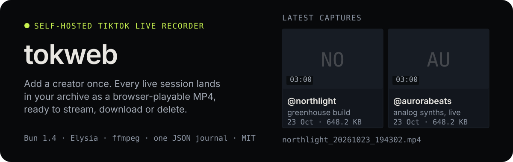
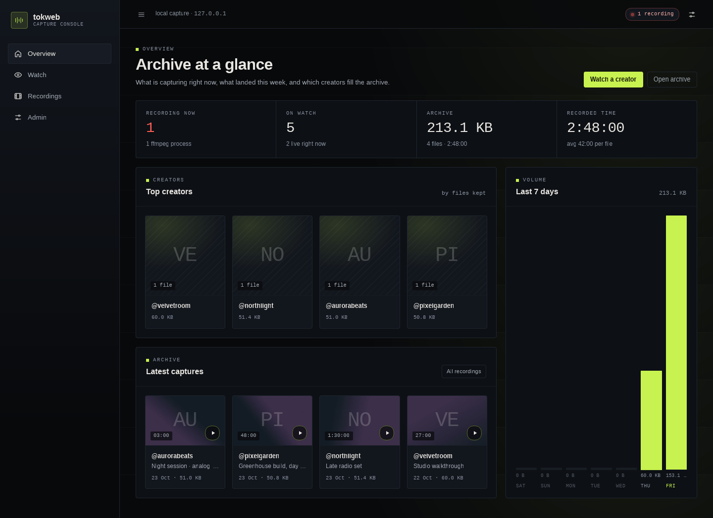
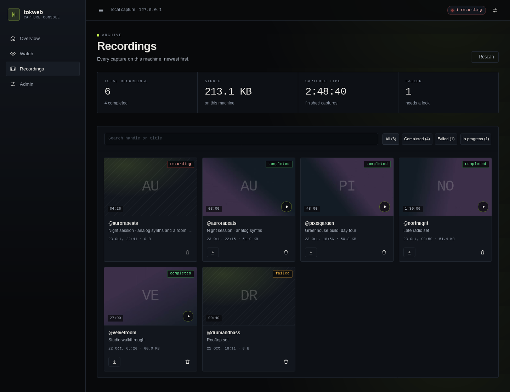
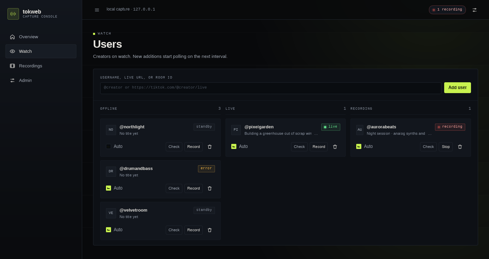

<p align="center">
  
</p>

<p align="center">
  <a href="#what-it-does">What it does</a> ·
  <a href="#quick-start">Quick start</a> ·
  <a href="#how-it-works">How it works</a> ·
  <a href="#pages">Pages</a> ·
  <a href="#http-api">HTTP API</a> ·
  <a href="#known-limits">Limits</a>
</p>

A web-first TikTok Live recorder for a machine you control. It polls the creators you add,
records each live session to an MP4 on your disk, and gives you a server-rendered UI to
search, play, convert, download, and delete what it captured. Clean-room implementation of
the feature surface of
[Michele0303/tiktok-live-recorder](https://github.com/Michele0303/tiktok-live-recorder);
no upstream source code is copied.

## What it does

- **Automatic capture.** Every monitor polls on its own interval and records only while the
  creator is live and auto-record is on for that user.
- **Crash-safe by design.** ffmpeg writes MPEG-TS first; on stop, stream end, or the duration
  cap, tokweb remuxes to a `+faststart` MP4 without re-encoding. A capture interrupted by a
  restart keeps its `.ts`, which the player converts on demand.
- **An archive, not a folder listing.** Generated thumbnails, durations, sizes, search, state
  filters, byte-range playback, audio-only captures in an `<audio>` player, download, delete.
- **Heals itself.** Delete or drop files in the output folder by hand and the index follows:
  the archive re-scans on boot, on every 5s poll, and on the **Rescan** button.
- **No database, no build step.** One JSON journal under `data/`, media under `recordings/`,
  Handlebars pages with htmx fragments. htmx, Alpine and Handlebars are served from
  `node_modules` through `/vendor/*`.

<p align="center">
  
  <br><sub>Overview — creators ranked by kept files, seven-day volume, latest captures.</sub>
</p>

<p align="center">
  
  <br><sub>Recordings — every capture on this machine, searchable and filterable.</sub>
</p>

<p align="center">
  
  <br><sub>Watch — users grouped by Offline, Live and Recording.</sub>
</p>

## Quick start

```bash
git clone https://github.com/zfadhli/tokweb && cd tokweb
bun install
bun start          # UI on http://127.0.0.1:3000
```

Then open the UI, go to **Watch**, paste a TikTok username, and flip **Auto** on that card.
When the creator goes live, the capture shows up under **Recordings**. Nothing else to run.

Requirements: Bun 1.2+ (built and tested on 1.4.4), `ffmpeg` on `PATH` (or set `ffmpegPath`
in Admin), and outbound access to TikTok. Cookies are optional unless your region blocks
the room API.

## How it works

1. Resolve the creator through TikTok's room API, with an HTML fallback when the API is blocked.
2. Pick the requested feed: `best`, `hd`, `sd`, or `audio`.
3. Spawn ffmpeg with `-c copy` into an intermediate TS. No quality loss, low CPU.
4. On stop, duration cap, or stream end, remux to MP4 (`+faststart`) and delete the TS. Set a
   bitrate in Admin to re-encode instead. If the remux fails, the TS is kept.
5. Update the journal, reconcile interrupted jobs on boot, and serve the archive with
   byte-range playback. Monitors resuming from the journal stagger their first live check by
   1.5s each, capped at 45s per sweep, so a restart does not fire every lookup at once.

## Pages

| Path | Purpose |
| --- | --- |
| `/` | Overview: live stats, top creators, seven-day volume, latest captures |
| `/watch` | Add a user; manage users in Offline / Live / Recording columns |
| `/recordings` | Archive grid with search, state filters, download, delete, Rescan |
| `/recordings/:id` | Player, metadata, convert `.ts` to MP4, download, delete |
| `/admin` | Capture defaults, paths, network, system status |

Pages are server-rendered Handlebars (`src/server/views`) with a per-process compile cache;
all formatting lives in `src/server/view.ts`, so templates only print. htmx swaps fragments
for polling and form actions, Alpine handles local UI state. There is no asset build step.

## HTTP API

JSON endpoints are separate from the pages and stay stable for scripting.

<details>
<summary>Endpoints</summary>

| Method | Path | Purpose |
| --- | --- | --- |
| `GET` | `/api/state` | Full snapshot: monitors, recordings, settings, system |
| `GET` | `/api/health` | Liveness and version |
| `GET` | `/api/events` | SSE snapshot stream |
| `POST` | `/api/probe` | Resolve `{ uniqueId \| url \| roomId }` without saving |
| `GET/POST` | `/api/monitors` | List / add (upserts by creator) |
| `PATCH/DELETE` | `/api/monitors/:id` | Update / remove |
| `POST` | `/api/monitors/:id/check` | Refresh room state |
| `POST` | `/api/monitors/:id/record` | Record now |
| `POST` | `/api/monitors/:id/stop` | Stop the active recording |
| `GET` | `/api/recordings` | Archive index |
| `GET` | `/api/recordings/:id/file` | MP4 with Range support |
| `GET` | `/api/recordings/:id/thumb` | Generated JPEG thumbnail |
| `GET` | `/api/recordings/:id/download` | Attachment |
| `DELETE` | `/api/recordings/:id` | Delete file and index entry |
| `GET/PUT` | `/api/settings` | Read (cookies masked) / update |

</details>

## CLI

The web UI always starts. Upstream-compatible flags use a single dash.

<details>
<summary>Flags</summary>

| Flag | Description |
| --- | --- |
| `-user <USER>` | Username(s), comma separated |
| `-url <URL>` | TikTok live URL |
| `-room_id <ID>` | TikTok room id |
| `-automatic_interval <MIN>` | Default poll interval in minutes |
| `-output <DIR>` | Recordings directory (default `./recordings`) |
| `-duration <SECONDS>` | Max segment length |
| `-proxy <URL>` | HTTP proxy for TikTok and ffmpeg |
| `-bitrate <BITRATE>` | Re-encode bitrate, e.g. `1M` or `1000k` |
| `-ffmpeg_path <PATH>` | ffmpeg binary |
| `-cookies <FILE\|HEADER>` | `cookies.json` or a raw Cookie header |
| `-variant <VARIANT>` | `best`, `hd`, `sd`, `audio` |
| `-port <PORT>` | Web UI port (default `3000`) |
| `-host <HOST>` | Bind address (default `127.0.0.1`) |
| `-data_dir <DIR>` | State directory (default `./data`) |
| `--help` | Usage |

`-telegram` and `-no-update-check` are accepted with a warning or ignored; Telegram upload
is not implemented.

</details>

## Cookies and exposure

Paste either format into Admin or pass `-cookies`:

```json
[{ "name": "sessionid", "value": "..." }, { "name": "ttwid", "value": "..." }]
```

```text
sessionid=...; ttwid=...
```

The client also fetches a `ttwid` automatically, and cookies usually help in blocked regions.
They are stored in plain text in `data/state.json`. The UI has **no authentication**: bind it
to `127.0.0.1` or put it behind your own proxy, and do not expose it to an untrusted network.

## Known limits

- TikTok rate-limits room lookups from some IPs (`HTTP 403` / `429`). The resolver retries,
  obtains a `ttwid`, and falls back to the live page; if every path is blocked, add cookies or
  a proxy.
- Monitors poll sequentially; large watchlists spread first checks on boot but recurring ticks
  are independent timers.
- HEVC or otherwise browser-incompatible streams need a bitrate set so the final file is
  re-encoded; otherwise the MP4 is a copy and may not play everywhere.
- The journal is a single JSON file owned by one process. Do not run two tokweb instances
  against the same `data_dir`.
- Telegram upload is out of scope for this web build.

## Development

```bash
bun test                 # unit/integration tests, no network
bun run typecheck        # TypeScript 7 native tsc
bun run e2e              # real HTTP + engine + ffmpeg + disk proof
bun run probe @creator --record 8
bun scripts/fixture.ts -port 4100   # seeded demo data, no polling, no TikTok
bun scripts/screenshot.ts http://127.0.0.1:4100/recordings /tmp/rec.png 1440 1100
```

`scripts/fixture.ts` boots the real routes against a throwaway data directory with one active
capture and a small archive, so screenshots stay deterministic. `bun run e2e` fakes only the
TikTok resolver: a generated video stands in for a live feed, then the script verifies the
monitor, recording, MP4, range endpoint, snapshot masking, deletion, and a spawned CLI server.

## Legal

Record only streams you have permission to record. Respect TikTok's terms, creator rights, and
local law. The software is provided as-is under the MIT license; the author is not affiliated
with TikTok or with the upstream project.
